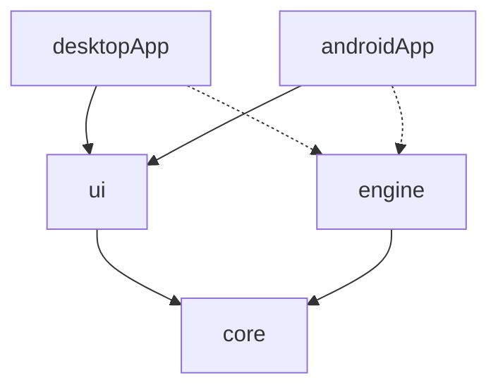

# GlyphDraft: architecture

Short on purpose. It says what is decided and what is already in code (M0), and lists what is open. Update it in the same pull request as any change to modules, boundaries or data locations. Reasons behind the choices are in `docs/decisions/`.

## Modules



| Module | Targets | Holds | State |
|---|---|---|---|
| `core` | jvm, android | `Outcome` result type; `OcrEngine`, `LanguageDetector`, `ModelCatalog`, `ModelInstaller` and domain types (`Language`, `ImageInput`, `RecognitionResult`, `ModelPack`), the `ImagePicker` and `TextSaver` seams, `ResultBridge`, stubs | in code (decision 0006); real implementations come in `engine` |
| `ui` | jvm, android | Compose Multiplatform screens (Home, Result, Settings) and `AppController` (state holder, navigation, actions), shared by both apps | in code |
| `desktopApp` | jvm | entry point, data folder, file log, FileKit file dialogs, jpackage app image for Windows and Linux | in code |
| `androidApp` | android | `MainActivity`, `MainViewModel` (composition root), system pickers, manifest, signing | in code |
| `engine` | jvm, android | on-device implementations of the engine interfaces (ONNX Runtime; Tesseract and Leptonica through JavaCPP): `OnnxSelfTest` (tiny model) and `TesseractSelfTest` (library load), both run at app start and logged; `OnnxNativeLibraries` and `JavaCppNativeLibraries` (desktop: native libraries into `<data>/native`); `models/`: `ModelManifest` (pinned URL, SHA-256, size per file), `FileModelCatalog`, `HttpModelInstaller` (decision 0007) | in code (M2 tasks 3 and 4); OCR comes in tasks 5 to 7 |

Rules: `core` has no UI or platform API. `ui` and `engine` depend only on `core`, never on each other. The two app modules are the composition roots: they create the engines and pass them to the UI (dotted arrows). Nothing else constructs an engine.

## Engine boundary (the part that must stay swappable)

The engine interfaces live in `core`, one per capability: text from an image (`OcrEngine`), language detection (`LanguageDetector`), translation (`Translator`), speech to text (`SpeechRecognizer`). The first two are fixed in M2 (decision 0006), the others are not. Beside them sit `ModelCatalog` (which model packs exist, which are installed, so which languages work offline) and `ModelInstaller` (download a pack with progress, cancellable). Rules for all of them:

- Calls are suspending and return `Outcome<T>`: failure is a value with a message, not an exception. Long work is cancellable.
- Inputs are plain data (encoded image bytes, an optional language hint), never a platform class; the engine decodes the image itself.
- The composition root picks the implementation from settings. On-device is the default; a cloud engine is a later second implementation of the same interface, chosen the same way (decision 0001).

## Data flow of the first feature (M2)

```
UI: pick image (+ optional language)
  -> view model
  -> OcrEngine.recognize(image, languageHint?)   -> text
  -> LanguageDetector.detect(text)                 (only when no hint was given)
  -> UI: show text and detected language, copy / save
```
M3 adds `Translator.translate(text, from, to)` after this chain; M4 adds a handwriting-capable `OcrEngine`; M5 adds `SpeechRecognizer` as a second input; M6 adds a camera as a third source of images.

## Platform-specific code

Shared by default. Platform code is limited to what the OS dictates: picking a file or image, camera and permissions (M6), the data folder and log file, and packaging. It sits in the app modules behind small interfaces in `core` (`ImagePicker`, `TextSaver`); decided in M1: interfaces, not `expect`/`actual`, for anything the apps own. `expect`/`actual` is used only for small UI-internal details in `ui` (clipboard entry, desktop scrollbar).

On Android the system pickers answer through callbacks of the activity, which is destroyed on rotation. `ResultBridge` (in `core`) turns such a callback into a suspending call that outlives the activity; `MainViewModel` owns the bridges and the `AppController`, so state and a pending picker survive rotation. Desktop dialogs are suspending (FileKit) and need no bridge.

## Data, logs and models

- **Desktop (in code):** data folder is `GLYPHDRAFT_DATA_DIR` if set (tests and smoke tests use it), else `%APPDATA%\GlyphDraft` on Windows, `$XDG_DATA_HOME/glyphdraft` or `~/.local/share/glyphdraft` on Linux. Log: `<data>/logs/glyphdraft.log`.
- **Last folder (desktop file dialogs):** `<data>/last-folder.txt` holds one line, the folder of the last chosen file; the dialogs start there. Not read when the folder no longer exists.
- **Android:** only logcat so far; the app-private data folder and a log file are decided with the first feature that needs them. Images and saved text go through the system pickers (no storage permission); the app keeps no copy.
- **ONNX Runtime natives (desktop, in code):** `<data>/native/` holds `onnxruntime.dll` or `libonnxruntime.so` and the JNI library, copied from the jar on first start (see `CLAUDE.md` for why not the temp folder). On Android the AAR's libraries are loaded from the APK (`arm64-v8a`, `x86_64`).
- **Models (in code, M2 task 4; not yet used by the apps):** `<data>/models/<pack folders>` (`ppocrv5/...`, `tessdata/...`), downloaded on first use with progress and a SHA-256 check, a file renamed into place only after the check; never committed or bundled. Offline after the first download. Android gets the `INTERNET` permission for this and nothing else; its data folder (`filesDir`) is wired in task 8.

## Build and release (summary)

One script, `scripts/build.ps1`, is run by CI and locally: license check, build with warnings as errors, tests, package, checksums, smoke test. Windows zip and Linux tar.gz come from the jpackage app image (built on their own OS); the Android APK from `assembleRelease`. Details: `CLAUDE.md`, `.github/workflows/`.

## Open, to be decided

- M2: model manifest and download design (task 4), the settings model (task 8). Engines are chosen in decision 0005.
- M4, M5: whether handwriting and speech need a larger engine than the first on-device one, and whether that is when the cloud engine arrives.
