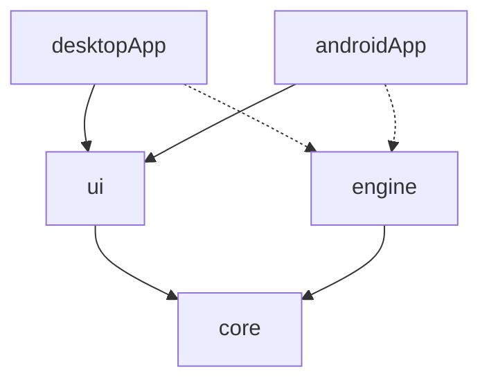

# GlyphDraft: architecture

Short on purpose. It says what is decided and what is already in code (M0), and lists what is open. Update it in the same pull request as any change to modules, boundaries or data locations. Reasons behind the choices are in `docs/decisions/`.

## Modules



| Module | Targets | Holds | State |
|---|---|---|---|
| `core` | jvm, android | `Outcome` result type; `OcrEngine`, `LanguageDetector`, `Translator`, `ModelCatalog`, `ModelInstaller` and domain types (`Language`, `ImageInput`, `RecognitionResult`, `Translation`, `ModelPack`; a translation model is a pack with a `TranslationDirection`, decision 0013; `TranslationRoutes` plans the chain of models for a pair, decision 0014), the `ImagePicker` and `TextSaver` seams, `ResultBridge`, stubs | in code (decision 0006); real implementations come in `engine` |
| `ui` | jvm, android | Compose Multiplatform screens (Home, Result, Settings), the first-use download dialog and the model list, and `AppController` (state holder, navigation, actions; takes the engines, `ModelCatalog` and `ModelInstaller`, offers the download of the missing packs of a read or of a translation route, and runs the translation flow, decisions 0018 and 0019), shared by both apps | in code |
| `desktopApp` | jvm | entry point, data folder, file log, FileKit file dialogs, window icon, jpackage app image for Windows and Linux; installer metadata (name, description, icons) in `build.gradle.kts` and `icons/` | in code |
| `androidApp` | android | `MainActivity`, `MainViewModel` (composition root), system pickers, manifest, launcher icon (adaptive vector), release signing from environment variables | in code |
| `engine` | jvm, android | on-device implementations of the engine interfaces (ONNX Runtime; Tesseract and Leptonica through JavaCPP): `OnnxSelfTest` (tiny model) and `TesseractSelfTest` (library load), both run at app start and logged; `OnnxNativeLibraries` and `JavaCppNativeLibraries` (desktop: native libraries into `<data>/native`); `models/`: `ModelManifest` (pinned URL, SHA-256, size per file), `FileModelCatalog`, `HttpModelInstaller` (decision 0007), `TranslationManifest` (the 13 translation directions as packs, decision 0014); `ocr/`: PP-OCRv5 pipeline over `PixelImage` (`ImageDecoder`, `TextDetector`, `TextRecognizer`, `PaddleOcr`, `PaddleModels`; decision 0008), `PaddleReader` (keeps the sessions, picks the recognizer), `TesseractHebrewReader` (Hebrew and the Hebrew probe over JavaCPP Tesseract; decision 0010) and `OnDeviceOcrEngine`, the `OcrEngine` that routes between packs and Hebrew (decision 0009), with `ReadQuality` (the `RecognitionResult.lowQuality` verdict, decision 0011); `language/`: `TextLanguageDetector` (script, then Latin word markers; shared code, no model); `layout/` (shared code, decision 0021): `PageLayout` decides from the places of the lines which breaks only wrap a paragraph (`LineJoiner` joins those) and where the gaps between blocks are, from the lines either reader gives (`PageTilt` levels the PP-OCRv5 ones); `translation/` (shared code, decision 0012): `TextSegmenter` cuts a text into paragraphs, lines and sentences and `SegmentedText.join` rebuilds the layout from the translated sentences, `UnigramTokenizer` (behind `SubwordTokenizer`) with `MarianVocabularyReader` reads the OPUS-MT `vocab.json` and `tokenizer.json` through a small `JsonReader`; `OnDeviceTranslator` is the `Translator` (segments, runs the route one direction at a time, closes the previous model before opening the next; decision 0015) over `DirectionTranslator`, `MarianConfigReader` and a `DirectionSource`; `OnnxDirectionSource`, `OnnxSentenceModel` and the two greedy decoders (with and without key/value cache) are the ONNX Runtime part (jvm and android); `OnDeviceEngine` (the wiring of all of the above: one catalog of the reading packs and the 13 translation packs, installer, `OcrEngine`, `Translator`; both apps build it and pass the translator to `AppController`; decision 0017), `AndroidImageDecoder` (BitmapFactory) and `log/FileLog` | in code (M2 tasks 3 to 8b) |

Rules: `core` has no UI or platform API. `ui` and `engine` depend only on `core`, never on each other. The two app modules are the composition roots: they create the engines and pass them to the UI (dotted arrows). Nothing else constructs an engine.

## Engine boundary (the part that must stay swappable)

The engine interfaces live in `core`, one per capability: text from an image (`OcrEngine`), language detection (`LanguageDetector`), translation (`Translator`), speech to text (`SpeechRecognizer`). The first two are fixed in M2 (decision 0006), the others are not. Beside them sit `ModelCatalog` (which model packs exist, which are installed, so which languages work offline) and `ModelInstaller` (download a pack with progress, cancellable). Rules for all of them:

- Calls are suspending and return `Outcome<T>`: failure is a value with a message, not an exception. Long work is cancellable.
- Inputs are plain data (encoded image bytes, an optional language hint), never a platform class; the engine decodes the image itself.
- The composition root picks the implementation from settings. On-device is the default; a cloud engine is a later second implementation of the same interface, chosen the same way (decision 0001).

## Data flow (M2 read, M3 translation)

```
UI: pick image (+ optional language)
  -> view model
  -> OcrEngine.recognize(image, languageHint?)   -> text (the lines of the page) and runningText (wrapped lines joined)
  -> LanguageDetector.detect(text)                 (only when no hint was given)
  -> UI: show text and detected language, copy / save
```
Translation (M3, in code) comes after this chain, when a target language is chosen (before the read, or later from the Result screen):

```
UI: target language
  -> catalog.packsForRoute(from, to)               (models of the route; missing ones are offered with the total size)
  -> Translator.translate(runningText, from, to)    -> Translation(text, from, to, route)
       OnDeviceTranslator: segment into paragraphs, lines and sentences -> per step of the route (en and ru are hubs):
       open the model of one direction, translate every sentence, close it -> rejoin the layout
       (e-mail addresses and web links never reach a model: AddressShield, decision 0020)
  -> UI: switch Translation / Original, copy / save of what is shown
```
The language that goes in as `from` is the one the read found (or the one the user chose); a target equal to it is not translated. `FixtureImageTranslationTest` runs this chain from image to translation with the real models. M4 adds a handwriting-capable `OcrEngine`; M5 adds `SpeechRecognizer` as a second input; M6 adds a camera as a third source of images.

## Platform-specific code

Shared by default. Platform code is limited to what the OS dictates: picking a file or image, camera and permissions (M6), the data folder and log file, and packaging. It sits in the app modules behind small interfaces in `core` (`ImagePicker`, `TextSaver`); decided in M1: interfaces, not `expect`/`actual`, for anything the apps own. `expect`/`actual` is used only for small UI-internal details in `ui` (clipboard entry, desktop scrollbar).

On Android the system pickers answer through callbacks of the activity, which is destroyed on rotation. `ResultBridge` (in `core`) turns such a callback into a suspending call that outlives the activity; `MainViewModel` owns the bridges and the `AppController`, so state and a pending picker survive rotation. Desktop dialogs are suspending (FileKit) and need no bridge.

## Data, logs and models

- **Desktop (in code):** data folder is `GLYPHDRAFT_DATA_DIR` if set (tests and smoke tests use it), else `%APPDATA%\GlyphDraft` on Windows, `$XDG_DATA_HOME/glyphdraft` or `~/.local/share/glyphdraft` on Linux. Log: `<data>/logs/glyphdraft.log`.
- **Last folder (desktop file dialogs):** `<data>/last-folder.txt` holds one line, the folder of the last chosen file; the dialogs start there. Not read when the folder no longer exists.
- **Settings (in code):** `<data>/settings.properties` (both apps): `theme` (System, Light, Dark) `defaultLanguage` (ISO code, absent = auto-detect) and `defaultTarget` (ISO code, absent = no translation). `SettingsStore` is in `core`, `FileSettingsStore` in `engine`; `AppController` loads at start and saves after each change, unknown keys and values are ignored, a failed save is shown as a notice. Written through a `.tmp` file and a move.
- **Android (in code):** data folder is the app-private `filesDir`; log `logs/glyphdraft.log` (and logcat), models in `models/`. Images and saved text go through the system pickers (no storage permission); the app keeps no copy.
- **ONNX Runtime natives (desktop, in code):** `<data>/native/` holds `onnxruntime.dll` or `libonnxruntime.so` and the JNI library, copied from the jar on first start (see `CLAUDE.md` for why not the temp folder). On Android the AAR's libraries are loaded from the APK (`arm64-v8a`, `x86_64`).
- **Models (in code, M2 tasks 4 and 8b):** `<data>/models/<pack folders>` (`ppocrv5/...`, `tessdata/...`, and `mt/<from>-<to>/` for each translation direction, 113 to 149 MB, `he-en` 370 MB), downloaded on first use with progress and a SHA-256 check, a file renamed into place only after the check; never committed or bundled. Offline after the first download. Android gets the `INTERNET` permission for this and nothing else; its data folder is `filesDir`.
- **Outside the data folder (desktop, known):** on Windows Skiko unpacks about 24 MB into `~/.skiko` (the Linux package did not create it in a WSL check, 2026-11-22); ONNX Runtime makes an empty `onnxruntime-java*` folder in the system temp folder and removes it on a normal exit. The README privacy section lists both.

## Build and release (summary)

One script, `scripts/build.ps1`, is run by CI and locally: license check, build with warnings as errors, tests, package, checksums, smoke test. Windows zip and Linux tar.gz come from the jpackage app image (built on their own OS); the Android APK from `assembleRelease`, signed with the release key on `v*` tags and manual runs (`docs/release-signing.md`), with the debug key otherwise. The icons are drawn by `scripts/icons/GenerateIcons.java` (desktop PNG and ICO) and by hand in `androidApp/src/main/res` (same geometry). Details: `CLAUDE.md`, `.github/workflows/`.

## Open, to be decided

- Moving Skiko's unpacked library into the data folder (not done; see Data section).
- M4, M5: whether handwriting and speech need a larger engine than the first on-device one, and whether that is when the cloud engine arrives.
